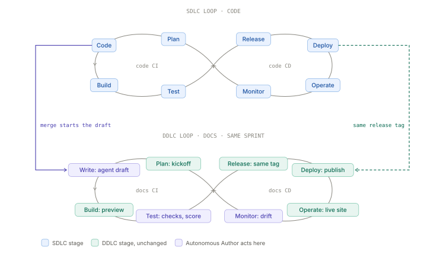
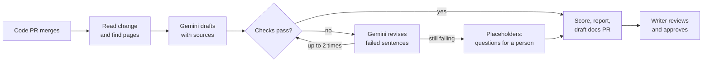
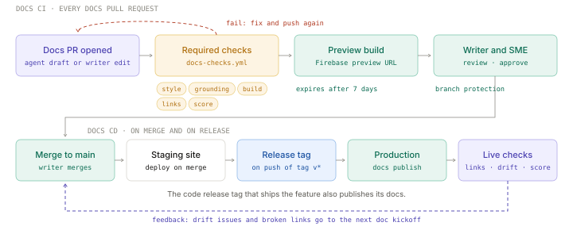

# The Autonomous Author

**The docs loop at the pace of the code loop: a first draft on every merge.**

Code and docs each run a DevOps loop. The Autonomous Author is an agent that
automates the one arc of the docs loop that is still manual: writing the first
draft. When a code pull request merges, the agent reads the change and its Jira
doc ticket, finds every docs page the change affects, and opens a draft docs
pull request within minutes. Each draft comes with an explainability report, a
confidence score from 1 to 10, and the source of every new sentence. A
technical writer reviews and approves every draft. The agent can't merge.

**[Read the design document](https://siddharthraop.github.io/The-Autonomous-Author/)**

## Status

Proof of concept, version 0.2 (October 2026). **Success test:** a developer
changes a feature in `product/` and pushes it to `main`; within minutes a draft
docs pull request opens with MyST changes, a confidence score and an
explainability report, and a writer must approve it.

### Try it

1. Change a default in `product/natctl/timeouts.py`, for example
   `"default": 120` to `"default": 30` for `tcp_time_wait`.
2. Add `Doc ticket: #<issue>` to the commit message (optional).
3. Push to `main`. The `autonomous-author` workflow opens a draft pull request
   from `author/<sha>`, posts the report, asks the change author any
   `[NEEDS INPUT]` questions, and runs `docs-checks` on the draft.

Locally: `pip install -e ".[model,test]" vale`, then `vale sync` and
`python -m pytest -q tests`. `author draft --base HEAD~1 --model none` drafts
in your working tree without opening anything.

### What is in the repository

| Path | What it is |
| --- | --- |
| `product/` | Sample code: NAT gateway timeouts, flags and output fields |
| `docs/` | Sample docs set in MyST Markdown, built with Sphinx |
| `author/` | The agent: eight tools, the agent loop, score and report |
| `.github/workflows/` | `autonomous-author`, `docs-checks`, `docs-deploy`, `record-review`, `drift-check`, `tests` |
| `adr/` | Where the build follows the design and where it differs |
| `index.html` | The design document |

## Two loops, one sprint

With docs as code, documentation is written with the same tools and workflow
as code: issue trackers, Git, plain-text markup, code review, and automated
tests ([Write the Docs: Docs as Code](https://writethedocs.org/guide/docs-as-code)).
That means docs can run the same DevOps loop as code: plan, build, test,
release, deploy, operate, and monitor.

At companies like Google, the two loops already turn in the same sprint. The
software development lifecycle (SDLC) is the code loop. The documentation
development lifecycle (DDLC) is the docs loop. A doc kickoff shares the epic
with sprint planning, a Jira doc ticket tracks the docs, and docs publish with
the release. Features don't ship without docs.



The two loops pair at five points:

| Stage               | Code loop (SDLC)                  | Docs loop (DDLC)                         | Where they pair         |
| ------------------- | --------------------------------- | ---------------------------------------- | ----------------------- |
| Plan                | Epic and sprint planning          | Doc kickoff and Jira doc ticket          | Same epic               |
| Code / Write        | Engineers write code, with AI help | Agent drafts, writer refines            | Merge starts the draft  |
| Test                | Does the code work?               | Is the text true and usable?             | Same CI, required checks |
| Release and deploy  | Rollouts and rollback             | Publish a docs version                   | Same release tag        |
| Operate and monitor | Uptime, errors, incidents         | Broken links, drift, docs support cases  | Shared support signal   |

One contrast shapes the design. In the code loop, tests check the code against
its specification. In the docs loop, the most useful test checks the docs
against the code. The Autonomous Author adds that test.

## The problem

The docs loop works. The pressure on it is pace.

-   More than a quarter of all new code at Google is generated by AI and then
    reviewed by engineers
    ([Alphabet Q3 2024 earnings remarks](https://blog.google/inside-google/message-ceo/alphabet-earnings-q3-2024/)).
-   The 2025 DORA report found that 90% of software development professionals
    use AI, and it linked AI adoption with higher software delivery throughput
    ([2025 DORA report](https://blog.google/technology/developers/dora-report-2025/)).

When the code loop turns faster, more changes merge in each sprint. Build,
test, release, and deploy already scale through pull requests and continuous
integration (CI). Write doesn't. For each merged change, a writer notices it,
reads the diff, finds every page that states the old behavior, and writes the
update by hand. That one manual arc sets the pace of the whole docs loop.

Keeping up has a measured value. DORA found that teams with above-average
documentation quality got a much larger performance lift from every technical
capability it studied. For continuous integration, the lift was 750% compared
with 34% for teams with below-average documentation
([DORA: Documentation quality](https://dora.dev/capabilities/documentation-quality/)).

## What it does

The Autonomous Author acts at three points on the docs loop:

-   **Write.** The code merge starts the draft. No one has to notice the
    change.
-   **Test.** Fixed checks test the docs against the code and compute a
    confidence score.
-   **Monitor.** A run log and a daily drift check show when draft quality
    falls.

For each merged change, the agent does the following:

1. Reads the diff, the pull request description, and the linked Jira doc
   ticket. It extracts each reader-visible change item, such as a new default
   value, a new flag, or a new API field.
1. Finds every docs page and line that mentions each change item, including
   values stored once as MyST substitutions.
1. Asks Gemini to edit the affected pages. For each new sentence, Gemini must
   name its source. When a fact has no source, Gemini writes a
   `[NEEDS INPUT: question]` placeholder instead of guessing.
1. Runs the style, grounding, and build checks. If a check fails, Gemini
   revises only the failed sentences, up to two times.
1. Computes the confidence score, opens a draft docs pull request with the
   report, asks the change author each open question, and moves the Jira doc
   ticket to review.
1. After the writer merges, recomputes the score on the merged text and
   records how much of the draft the writer changed.



### Design principles

-   **The model drafts. The checks decide.** Every pass or fail result and the
    confidence score come from plain Python tools that give the same result
    every time. The model never scores its own work.
-   **No fact without a source.** Every number, unit, flag, field, and command
    in a new sentence must appear in its cited source. Facts that have no
    source become questions for a person.
-   **A writer approves every draft.** Branch protection on the docs repository
    requires passing checks and a writer's review before merge
    ([GitHub: About protected branches](https://docs.github.com/en/repositories/configuring-branches-and-merges-in-your-repository/managing-protected-branches/about-protected-branches)).
-   **The model is called less over time.** When a writer approves the same
    kind of fix more than once, it becomes a fixed rule in the tools.

## The docs CI/CD pipeline

The agent is one contributor to a docs pipeline that treats every docs pull
request the same way, whoever wrote it.



| Pipeline rule               | How it works                                                                                                       |
| --------------------------- | ------------------------------------------------------------------------------------------------------------------ |
| One set of checks           | Style, grounding, build, links, and score live in one reusable workflow, `docs-checks.yml`, triggered by `workflow_call` ([GitHub: Reuse workflows](https://docs.github.com/en/actions/how-tos/reuse-automations/reuse-workflows)). The agent and every docs pull request run it. |
| Checks block merge          | Branch protection requires the checks to pass and a writer to approve.                                             |
| Review the rendered page    | Each pull request gets a Firebase Hosting preview URL from a GitHub Action ([Firebase: Test and preview](https://firebase.google.com/docs/hosting/test-preview-deploy)). Preview channels expire after 7 days by default ([Firebase: Manage Hosting resources](https://firebase.google.com/docs/hosting/manage-hosting-resources)). |
| Merge isn't publish         | Merge to `main` deploys to a staging site, so docs for unreleased features stay unpublished.                       |
| Publish on the code release | A workflow on a tag push, filtered to `v*`, deploys staging to production ([GitHub: Workflow syntax](https://docs.github.com/en/actions/reference/workflows-and-actions/workflow-syntax)). Docs and code ship on the same event. |
| Close the loop              | A daily job checks live links and the run log for drift, and opens issues for the next doc kickoff.                |

## Confidence score

The confidence score tells the writer how much review a draft needs. The tools
compute it from check results only.

| Part            | Weight | How the tool measures it                                          |
| --------------- | -----: | ----------------------------------------------------------------- |
| Grounding       |    3.5 | Sentences with a checked source divided by new sentences          |
| Coverage        |    2.5 | Change items in the draft divided by change items in the change   |
| Stale values    |    1.5 | Full points when no replaced value is left on any affected page   |
| Style           |    1.5 | Minus 0.5 for each Vale error and 0.1 for each warning            |
| Build and links |    1.0 | Full points when the Sphinx build and every link pass             |
| Open questions  |      − | Minus 0.5 for each placeholder; the score never falls below 1     |

| Score      | Label            | What the writer does                                   |
| ---------- | ---------------- | ------------------------------------------------------ |
| 8.5 to 10  | Ready for review | Checks wording and structure. Every fact has a source. |
| 6.0 to 8.4 | Review closely   | Works through the open questions in the report.        |
| 1.0 to 5.9 | Needs writer     | Uses the draft as notes.                               |

These weights are MVP starting values. They're tuned from review data so that a
higher score means fewer writer edits.

### Sample report

Each draft pull request starts with a report comment like the following:

```text
Docs PR #218 · doc ticket NAT-1182 · Confidence 8.3 / 10 · review closely
3.5 grounding + 2.5 coverage + 1.5 stale values + 1.3 style + 1.0 build − 1.5 questions

Sources
  S1  Code PR #4471: router_nat/timeouts.py diff and flag help text
  S2  Jira NAT-1182: doc type task, audience network operators
  S3  nat/tune-nat-configuration.md, nat/troubleshooting.md
  S4  substitutions.yml: nat_tcp_time_wait_default
  S5  Vale Google package, version pinned in this repository

Check these
  question  Which gateways get the 30-second default? (asked of the change author)
  question  Is the minimum value a hard limit or a recommendation? (asked of the change author)
  question  Should the release note link to this section? (asked of the writer)
  revised   Sentence 4 said "in all regions" with no source; now a placeholder
  style     2 Vale warnings: Google.Parens, Google.Will
```

## Observability and drift detection

Agent Development Kit (ADK) sends a trace of every model and tool call to
Cloud Trace through OpenTelemetry
([ADK: Cloud Trace](https://adk.dev/integrations/cloud-trace/)). Each run also
writes one row to a BigQuery run log with the model ID, prompt version, scores,
tokens, and time. Once a day, a drift check compares the last 10 runs with a
baseline of 20 approved runs.

| Drift type           | Signal                                                | Response                                  |
| -------------------- | ----------------------------------------------------- | ----------------------------------------- |
| Quality drift        | Mean confidence score falls 1.0 below baseline        | Opens a drift issue that names the runs   |
| Review drift         | Writers change more of each draft than before         | Opens a drift issue                       |
| Grounding drift      | More than 5% of new sentences end as placeholders     | Opens a drift issue                       |
| Configuration change | Model ID, prompt version, or Vale version changes     | Replays the evaluation set before go-live |
| Input drift          | A change type the baseline hasn't seen                | Flags the report and adds a replay case   |

The evaluation set is a list of past Cloud NAT changes, with the published
pages as reference answers. The replay uses ADK's `response_match_score` and
`hallucinations_v1` criteria
([ADK: Evaluation criteria](https://adk.dev/evaluate/criteria/)).

## Technology

The MVP runs on Google Cloud and free or open-source tools.

| Part                    | Technology                                   | Free tier or license                                    |
| ----------------------- | -------------------------------------------- | ------------------------------------------------------- |
| Agent framework         | [Agent Development Kit](https://github.com/google/adk-docs) | Apache 2.0                                 |
| Model                   | Gemini 3.8 Flash (`gemini-3.8-flash`)        | [Gemini API free tier](https://ai.google.dev/gemini-api/docs/pricing) |
| Agent runtime           | Cloud Run service                            | [180,000 vCPU-seconds a month](https://cloud.google.com/run/pricing) |
| Daily drift check       | Cloud Run job and Cloud Scheduler            | [3 Scheduler jobs per billing account](https://cloud.google.com/scheduler/pricing) |
| Run log                 | BigQuery                                     | [10 GiB storage and 1 TiB of queries a month](https://cloud.google.com/bigquery/pricing) |
| Traces                  | Cloud Trace                                  | Through ADK's OpenTelemetry support                     |
| Docs sites              | Firebase Hosting: preview, staging, production | [10 GB storage and 360 MB a day on the no-cost plan](https://firebase.google.com/pricing) |
| Style checks            | [Vale](https://vale.sh/) with the [Google package](https://vale.sh/hub/google/) | Package licensed under CC BY 4.0 |
| Build and links         | Sphinx, MyST Markdown, and [lychee](https://github.com/lycheeverse/lychee-action) | Open source |
| Pipeline and review gate | GitHub Actions and branch protection        | [Free for public repositories](https://docs.github.com/en/billing/concepts/product-billing/github-actions) |
| Doc tickets             | [Jira Cloud REST API](https://developer.atlassian.com/cloud/jira/platform/rest/v3/intro/) | Read and update only |

**Data handling.** The sample content is public, so the Gemini API free tier
is acceptable for the MVP. Content sent on the free tier is used to improve
Google products, so private code and docs need the paid tier
([Gemini API pricing](https://ai.google.dev/gemini-api/docs/pricing)).

## View locally

The design document is a single HTML page with no build step.

1.  Clone the repository:

    ```sh
    git clone https://github.com/siddharthraop/The-Autonomous-Author.git
    cd The-Autonomous-Author
    ```

1.  Start a local web server:

    ```sh
    python3 -m http.server 8000
    ```

1.  In your browser, go to `http://localhost:8000`.

You can also open `index.html` directly in a browser.

## Repository contents

| File or folder | Description                                          |
| -------------- | ---------------------------------------------------- |
| `index.html`   | The design document, published with GitHub Pages     |
| `images/`      | Diagrams used in this README                         |
| `README.md`    | This file                                            |
| `LICENSE`      | MIT License                                          |
| `.gitignore`   | Files that Git ignores                               |

## Sample content and attribution

The sample content is adapted from the Google Cloud
[Cloud NAT release notes](https://docs.cloud.google.com/nat/docs/release-notes)
and the
[Tune NAT configuration](https://docs.cloud.google.com/nat/docs/tune-nat-configuration)
page. Google publishes this content under the
[Creative Commons Attribution 4.0 License](https://creativecommons.org/licenses/by/4.0/),
as described in the
[Google Developers Site Policies](https://developers.google.com/site-policies).
The adapted content is modified from the original.

The sample code change, pull request numbers, and Jira tickets are written for
this design and aren't Google source code or Google records.

This is a portfolio project. Google hasn't engaged, sponsored, or endorsed this
work. Stakeholders in the design document are job roles, not real people, and
the readers are fictional.

## Part of a series

This project is the second in a series of design documents. Each one solves
one economic problem in documentation.

1.  [MANIFEST](https://siddharthraop.github.io/Manifest/): migrate DITA XML to
    docs as code and prove that no content was lost.
1.  **The Autonomous Author**: run the docs loop at the pace of the code loop,
    with a first draft on every merge.

## Contact

Siddharth Rao. To ask a question or suggest a change,
[open an issue](https://github.com/siddharthraop/The-Autonomous-Author/issues).

## License

The design document, diagrams, and code in this repository are licensed under
the [MIT License](LICENSE). Adapted Google content remains under the Creative
Commons Attribution 4.0 License.
